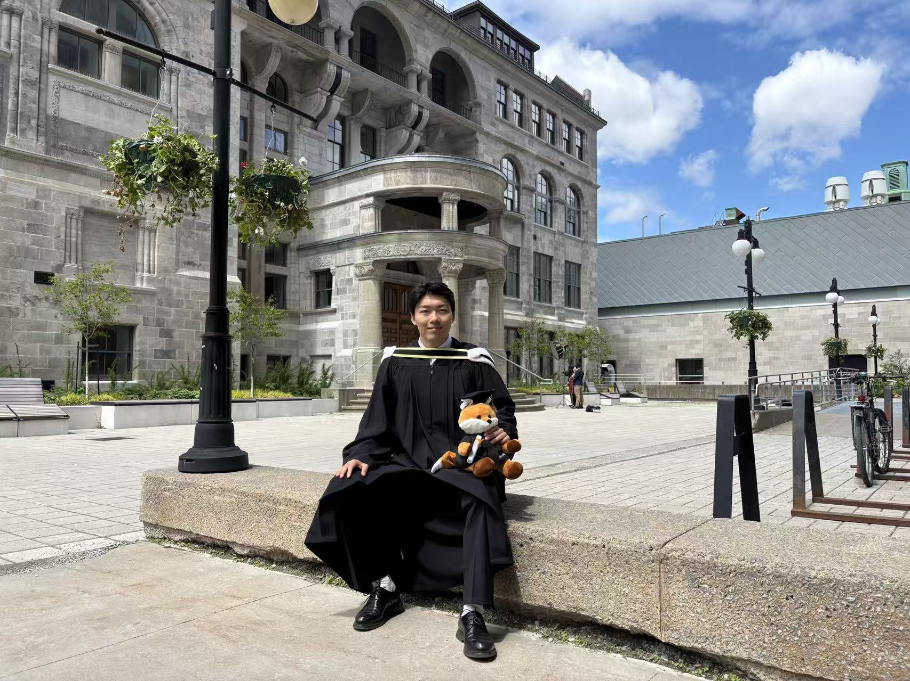

# Hi, I'm Qiaoen!

I'm currently pursuing an M.S. in Biostatistics
at Columbia University's Mailman School
of Public Health.

Before coming to Columbia, I completed
my B.Sc. in Statistics with a minor in
Economics at McGill University.

## About Me

My academic interests include missing data, survey design, Bayesian methods, and applications of statistics to health research.

I enjoy using quantitative methods to address
real-world problems, particularly in healthcare
and public health.

## Explore My Website

- [Resume](resume.html):
  Learn more about my academic background,
  research, and professional experience.

- [Personal Life](personal_life.html):
  A glimpse into my life outside of academics.

## Connect With Me

Feel free to reach out or explore my projects!

- **GitHub:** [qiaoen-xia](https://github.com/qiaoen-xia)
- **Email:** [qx2277@cumc.columbia.edu](mailto:qx2277@cumc.columbia.edu)

