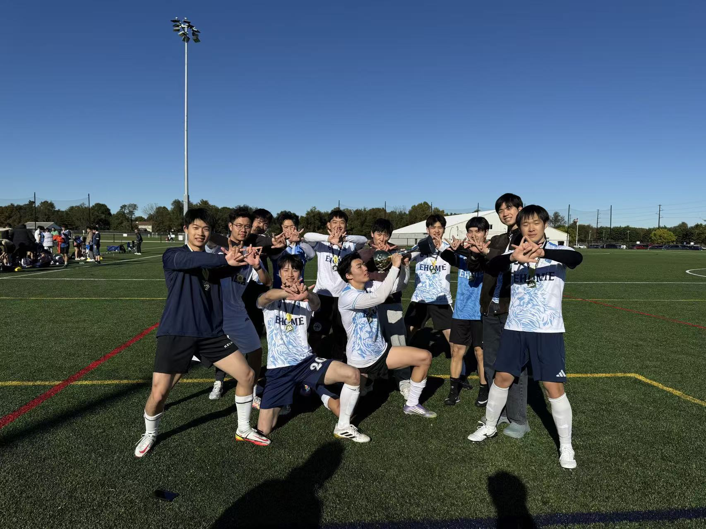
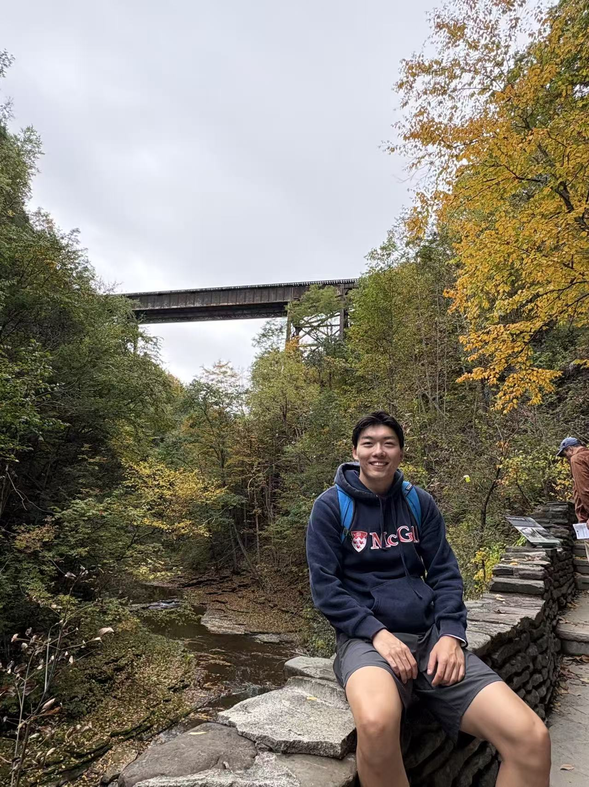
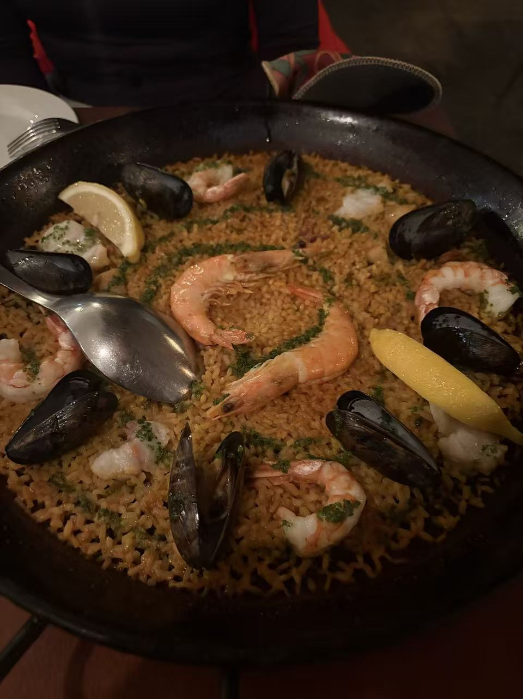

---
title: "Personal Life"
---

# Beyond Academics
While statistics and research are important parts of my life, I believe there's much more to life than academics. I always strive to make my life diverse, exciting, and full of new experiences. Whether it's playing soccer, cooking, traveling, or trying something new, I enjoy exploring different interests and making the most of everyday life.

# Soccer

Soccer has always been one of my biggest passions. I'm a huge fan of FC Bayern Munich, and Harry Kane is my favorite player.

Beyond watching soccer, I also love playing the game myself. I usually play as a midfielder, a position I enjoy because it allows me to be involved in both attacking and defending, connect with my teammates, and influence the flow of the game.

For me, soccer is not just about competition, but also about teamwork, friendship, and the joy of being on the pitch.

# Travel & Exploring

I enjoy traveling and discovering new places.

Having studied in Montreal and now living
in New York City, I love experiencing
different cultures, neighborhoods,
and local food.

# Cooking

I enjoy cooking and experimenting with different recipes.

I love trying new dishes, exploring different cuisines,
and sharing homemade meals with friends and family.

